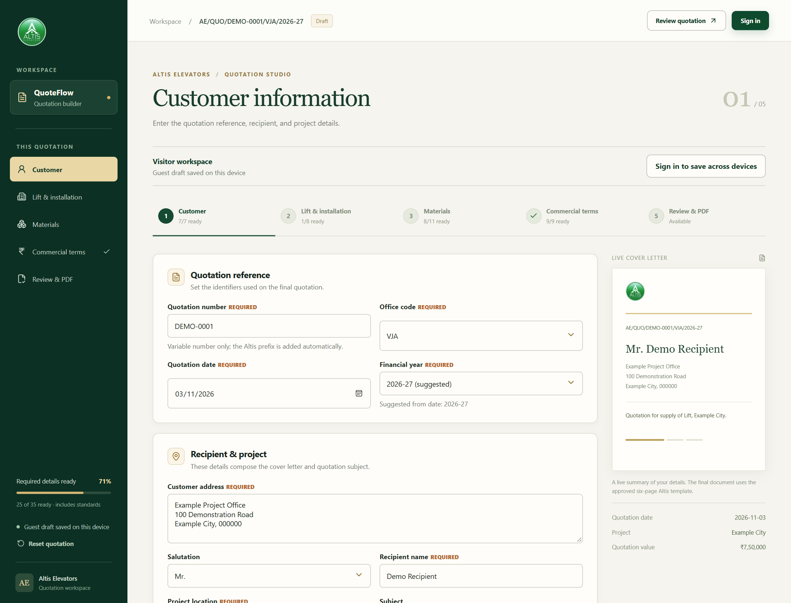
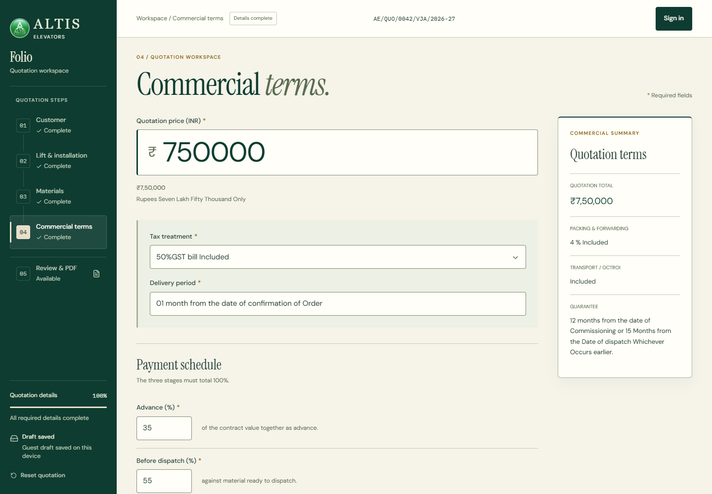

# Folio

Folio is a quotation workspace developed for **Altis Elevators**. It brings lift selection, project details, commercial terms and document preparation into one guided workflow, reducing repeated entry while keeping quotations consistent with the company's catalogue and approved format.

**[Open the live application](https://quote-flow-azure.vercel.app/)**

The application is deployed on Vercel with Firebase Authentication and Cloud Firestore. Visitors can begin a quotation locally; verified accounts can save private drafts across devices, add shared lift models, and generate six-page quotation PDFs.

## Quotation workflow

| Step | What the employee does |
| --- | --- |
| **1. Customer** | Enter the reference, date, recipient, address and project location. |
| **2. Lift & installation** | Search configurations, enter capacity and site measurements, and make explicit technical overrides. |
| **3. Materials** | Review catalogue-derived and standard specifications; customize the quotation where needed. |
| **4. Commercial terms** | Enter the INR price and confirm tax wording, delivery, payment stages and other terms. |
| **5. Review & PDF** | Resolve missing details, inspect the quotation, choose a PDF version and download when ready. |

Employees can move directly between sections. Inputs are retained while navigating, and missing-detail links lead back to the relevant controls.

## Key features

- **49 Excel-derived configurations:** searchable by description, category and approved technical characteristics, with source IDs and workbook rows retained.
- **Controlled customization:** technical and material overrides apply to the quotation; original catalogue values remain intact and can be restored.
- **Practical entry controls:** structured dimensions, standard/custom floor arrangements, financial-year suggestions, and Indian price formatting with amount in words.
- **Firebase sign-in:** email/password registration, email verification and guest-to-account continuity without replacing existing saved quotations.
- **Private cloud autosave:** per-user drafts, cross-device restoration, local recovery copies and explicit choices when saved versions conflict.
- **Shared lift models:** verified users can add models to a separate shared library without changing the original Excel catalogue.
- **Shared entry options:** verified users can save reusable passenger/load pairs and material specifications for the team. Applying an option customizes the current quotation; it does not create a catalogue standard or new PDF row.
- **Two six-page PDF options:** Branded and Print-friendly, generated from the same quotation data used by Review.
- **Responsive workflow:** desktop and mobile layouts, keyboard navigation, contextual editing links and visible save feedback.

## Screenshots

These are real captures of the deployed application using **synthetic quotation data** in an isolated visitor session. Names, addresses, amounts and editable commercial wording shown here are illustrative; they are not customer records, historical prices or approved specification examples.

**Customer workspace and live quotation summary**



**Price entry and quotation-specific commercial wording**



Altis branding visible in these screenshots remains subject to the proprietary-materials notice below.

## PDF preview and export

Both versions use the same resolved quotation and retain its six-page structure, technical values, commercial terms and contractual body text.

| Version | Presentation |
| --- | --- |
| **Branded** | Original Altis logo, watermark, green sidebar, ISO statement and yellow company-contact box, with date and signature footers. |
| **Print-friendly** | Text and black table borders, without images, watermark, green sidebar, ISO statement or the yellow contact box. **Date and executive/customer signature footers on Pages 2–6 are retained.** |

A verified account is required for PDF generation. Incomplete quotations can be previewed with missing values left blank; final download requires export readiness and successful rendering. The version selector regenerates the preview and matching download together. Filenames use the quotation reference, with `-print-friendly` added for that version.

## Technology

| Area | Stack |
| --- | --- |
| Application | React 19, Vite, JavaScript |
| Interface | Base UI, Lucide React, CSS design tokens |
| Accounts and persistence | Firebase Authentication, Cloud Firestore Lite, browser localStorage |
| Documents | `@react-pdf/renderer` |
| Catalogue tooling | SheetJS (`xlsx`), Node conversion and validation scripts |
| Verification | Node test runner, Firestore rules-unit testing and emulator, ESLint |
| Hosting | Vercel |

## Architecture

The application separates reference data, quotation state and document presentation:

```text
Authoritative Excel workbook
    → conversion + validation
    → versioned JSON catalogue
          ↓
Catalogue selection + quotation inputs + overrides + approved template
          ↓
Canonical quotation document resolver
          ↓
Review → Branded PDF / Print-friendly PDF
```

The JSON catalogue is a local application asset, not a live Excel connection. Conversion preserves record IDs, worksheet rows and unresolved source information. Employee-added models are stored separately in Firestore and carry their own identifiers.

Quotation state uses schema v4. Review and both PDF versions consume the same resolved-document model; document components do not independently select specifications or calculate commercial values.

| Data | Storage and access |
| --- | --- |
| Visitor quotation | Local browser draft; imported as a separate draft after verified sign-in. |
| Employee quotations | Private Firestore drafts owned by that account, with account-scoped local recovery copies. |
| Employee-added lift models | Shared Firestore collection available to verified accounts; separate from private quotations and the 49-record catalogue. |
| Employee-added capacity/material options | Append-only shared `quotationOptions` collection; values are copied into a quotation only when explicitly chosen. |

Cloud conflicts preserve alternatives rather than silently overwriting a newer quotation. Shared models are append-only through the application.

## Local development

Use **Node.js 22.12+ or Node 24** and npm. Java 21+ is needed only for Firestore emulator checks.

```sh
git clone https://github.com/RustedIronn/QuoteFlow.git
cd QuoteFlow
npm ci
cp .env.example .env.local
```

In PowerShell, `Copy-Item .env.example .env.local` can be used for the copy step.

Fill the ignored `.env.local` file with the public Web app configuration for the Firebase project you intend to use:

| Variable | Firebase Web configuration |
| --- | --- |
| `VITE_FIREBASE_API_KEY` | `apiKey` |
| `VITE_FIREBASE_AUTH_DOMAIN` | `authDomain` |
| `VITE_FIREBASE_PROJECT_ID` | `projectId` |
| `VITE_FIREBASE_APP_ID` | `appId` |

Enable Email/Password Authentication, configure Firestore with the repository's rules, and authorize the actual development hostname in Firebase Authentication. Keep email verification enabled. Firestore rules authorize verified accounts, isolate drafts by UID, and keep shared models separate.

```sh
npm run dev
```

Open the address printed by Vite. Visitor entry and the approved catalogue are available without Firebase configuration; employee cloud features and PDF generation require a configured connection and verified account.

```sh
npm run build
npm run preview
```

The production build is written to `dist/`. Vite embeds the public Firebase configuration at build time, so environment changes require a new build.

## npm scripts

| Command | Purpose |
| --- | --- |
| `npm run dev` | Start the development server. |
| `npm run build` | Build the application for production. |
| `npm run preview` | Serve the production build locally. |
| `npm run lint` | Run ESLint. |
| `npm test` | Run application tests; the rules suite is explicitly skipped when no emulator is configured. |
| `npm run test:rules` | Start the isolated Firestore emulator and run security-rule tests, or use an existing emulator. Requires Java 21+. |
| `npm run test:emulators` | Run the complete test suite with Firestore security tests enabled. Requires Java 21+. |
| `npm run catalogue:build` | Rebuild catalogue JSON and its validation report from the authoritative workbook. |
| `npm run catalogue:check` | Check that catalogue JSON still matches the workbook and conversion rules. |

During development, run focused tests for the change. Before application releases, run the complete tests, catalogue check, lint and build. The emulator runner targets the isolated `demo-quoteflow` project.

## Project structure

```text
src/
  app/                  Workflow screens, controls and presentation helpers
  data/catalogue/       Excel-derived catalogue JSON
  models/               Quotation schema, migrations and workspace state
  services/             Firebase account, shared-model and private-draft access
  templates/            Approved Altis document content and defaults
  pdf/                  Shared six-page renderer, preview and download
data/source/            Authoritative catalogue workbook; private local inputs
data/reports/           Catalogue validation results
scripts/                Conversion, emulator and PDF verification tooling
tests/                  Domain, persistence, security and rendering tests
docs/                   Product screenshots and ignored private PDF reference
public/assets/          Application and document branding
```

## Security and document handling

- Firestore rules enforce verified-account access, private draft ownership, revision checks and validation of shared-model additions.
- **The current authorization policy accepts every verified Firebase account.** It does not use employee approval lists or company-domain restrictions.
- Quotation drafts are private to their owner. Sharing a lift model does not share the author's quotations.
- Firebase Web configuration is public client configuration. Service-account keys, Admin credentials and other secrets must never be placed in `VITE_*` variables or frontend code.
- Local recovery uses browser storage, not an encrypted vault. Signing out hides employee quotations in the interface while retaining account-scoped recovery data on that device.
- PDFs are generated client-side. Sign-in and export-readiness checks govern the application workflow; there is no server-issued signing or document-approval service.
- Customer workbooks, reference quotations and local environment files must stay out of Git and `public/`. Files in `public/` are served with the application.

### Publication review

Company-specific materials are already tracked in this repository. Their presence does not establish permission to redistribute them. Obtain the applicable rights holders' approval; if publication is not authorized, remove or redact the material from the public repository and assess its Git history.

| Material to review | Why it needs review |
| --- | --- |
| `data/source/lift-models.xlsx` | Original Altis catalogue and technical source information. |
| `src/data/catalogue/liftCatalogue.json`, `data/reports/liftCatalogue.validation.json` | Catalogue-derived specifications, source cells and data-quality details. |
| `public/assets/` | Altis logos, branding and document watermarks. |
| `src/templates/altisQuotationTemplate.js` | Company-specific quotation, commercial and contractual wording and contact information. |

The private `customerdetails.xlsx` and `liftsquery.xlsx` workbooks, customer reference PDF and `.env.local` are ignored and untracked in the reviewed checkout. Keep them private. Ignore rules do not remove files previously committed.

## Current limitations and future work

- One lift configuration per quotation.
- Private per-user quotation storage; no collaborative editing or cross-employee quotation sharing.
- Local guest drafts require the same browser until imported into a verified account.
- Cloud recovery across devices requires a connection; pending local changes are preserved when cloud saving fails.
- Catalogue updates use a deliberate Excel-to-JSON conversion, without live Excel synchronization.
- Passenger capacity and maximum load remain employee-selected or entered; they are not inferred from model names or historical frequency.
- No automatic quotation numbering, digital signatures or historical customer imports.
- Travel uses the existing Altis total-floor convention and prints a numeric value with `G +`; this should not be interpreted as a physical travel distance.

Future work includes approved catalogue enrichment, further physical-device accessibility checks and release automation. These are prospective improvements, not current capabilities.

## Copyright, Trademarks & Proprietary Materials

Folio was developed for the Altis Elevators quotation workflow. Altis Elevators' branding, names, logos, approved quotation templates, technical specifications and company-specific data remain proprietary to their respective rights holders.

Public repository visibility does **not** grant permission to commercially reuse those proprietary materials. Obtain permission from the applicable rights holders before using them in another product, service or commercial document.

The Altis name and branding identify the intended business context. This notice does not assert registered-trademark status or assign ownership of Folio's source code to Altis Elevators.

No open-source license is currently included in this repository. This notice does not create a software license or grant additional rights; third-party dependencies remain subject to their own applicable licenses.
